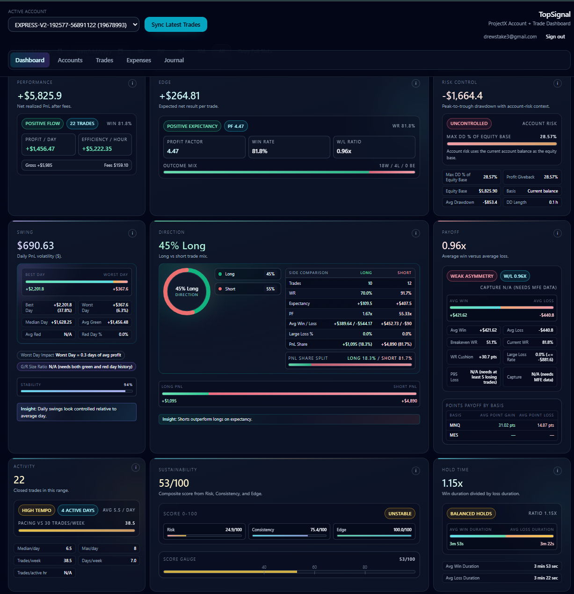
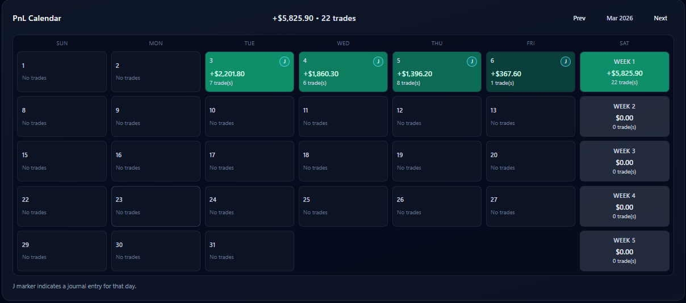
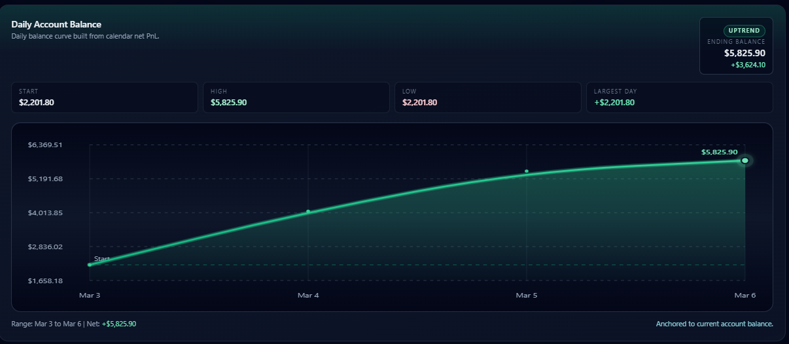
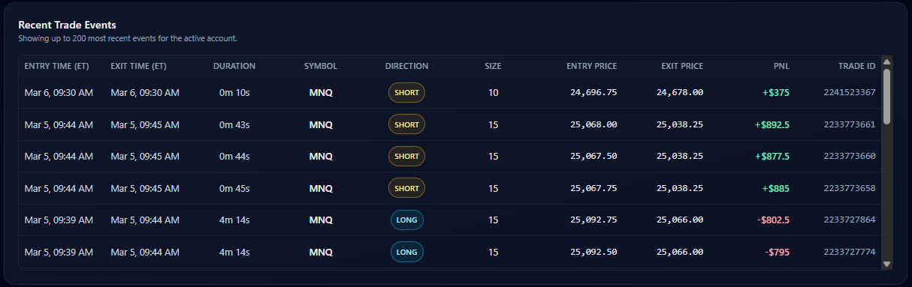
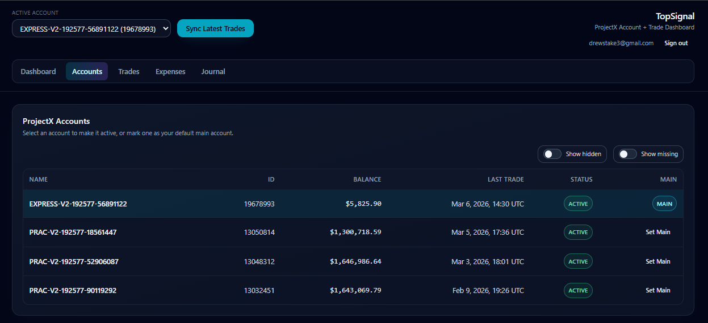
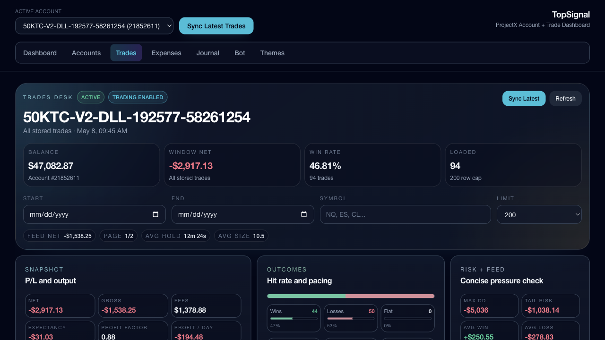
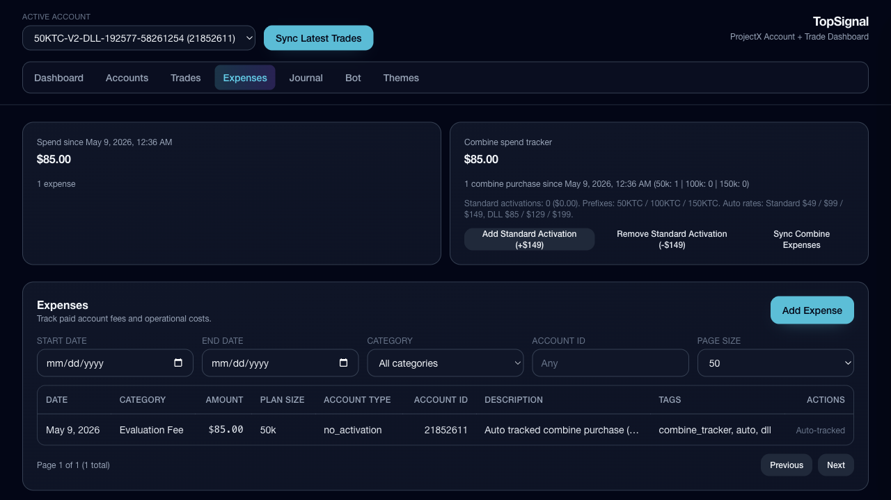
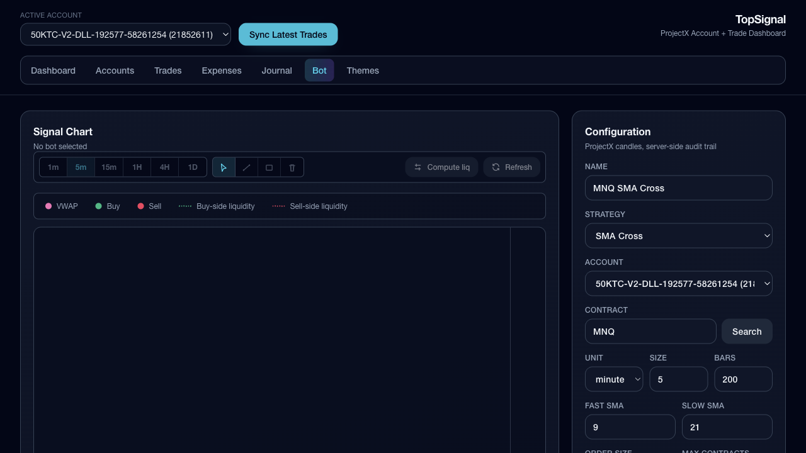
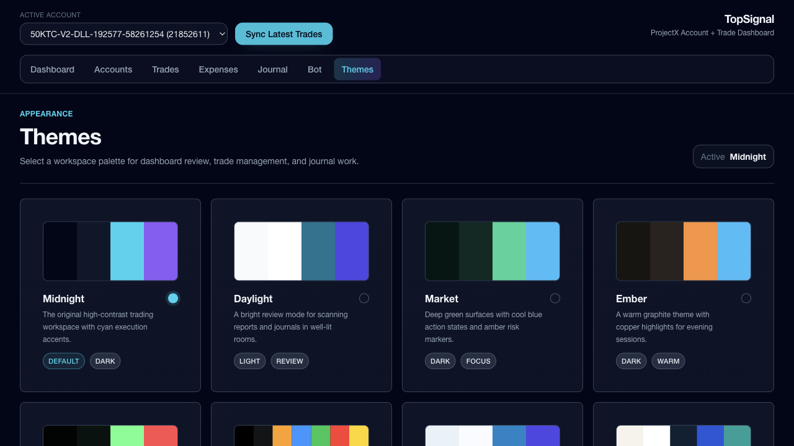

# Account workspace walkthrough

These screenshots show earlier versions of the workspace. Follow the [route map](../README.md#frontend-routes) to find each screen in the current checkout.

## Dashboard

The dashboard is the main account analytics surface. It is account-scoped by default and can switch into an analytics-only Copy Trade Mode for combined leader/follower account review.

It shows:

- headline performance and edge metrics
- drawdown and risk-control context
- long-vs-short breakdowns
- payoff and activity metrics
- sustainability scoring
- a trading-day PnL calendar
- a Topstep trade-file preview/import panel with exact gross P&L, fees, commissions, and net P&L
- a daily account-balance curve derived from the calendar
- a recent trade-event feed
- optional combined copied-account stats for leader/follower workflows

Dashboard overview:



Calendar drill-down:



Balance curve derived from the selected trading range:



Recent execution review feed:



Important dashboard behaviors:

- The active account comes from the global account picker in the app shell.
- The page can sync trades, change time range, and drill into a specific trading day.
- Topstep CSV/XLSX exports can be reviewed and confirmed directly above the P&L calendar; duplicate source IDs are skipped.
- Clicking a PnL-calendar day filters the trade feed to that trading day.
- `Summary` opens a coach-style trading summary for the selected dashboard range, including verdict, sample quality, top levers, risks, improvements, and a short action plan.
- `Copy Full Stats` copies a text payload for the selected dashboard range.
- `Copy Trade Mode` can combine the selected leader account with up to four follower accounts for adjusted dashboard totals.
- When Copy Trade Mode is active and calculable, headline metrics, daily PnL, balance context, and calendar data use combined leader/follower results. Otherwise the dashboard shows the selected account only.
- Copy Trade Mode shows leader contribution, follower contribution, copied account count, follower-only PnL, warnings, and resettable likely-uncopy event tracking.
- Copy Trade Mode settings and uncopy-event reset timestamps are stored in browser storage. This mode does not place orders or enable live trade copying.
- The dashboard uses `summary-with-point-bases` so it can render one summary request plus point-payoff comparisons instead of fanning out multiple summary calls.

## Accounts

The Accounts page is the account-management surface for ProjectX-synced and
Live CSV accounts.

A user can:

- view discovered accounts
- see current balance, state, and last known trade timestamp
- toggle hidden and missing accounts into view
- mark one account as the main account
- set the active account used across the rest of the app
- override the provider account name with a local display name
- use the dashboard's `Live Account (CSV)` control to switch to a separate
  local Live account backed by manually imported Topstep trades
- create Live accounts with a name and opening balance; TopSignal generates and
  hides the internal routing key and derives current balance from imported net P&L
- resolve the last trade timestamp from the provider when local data is stale or absent

Accounts page:



TopSignal tracks four account states:

- `ACTIVE`: visible and tradable
- `LOCKED_OUT`: account exists but cannot trade
- `HIDDEN`: provider returned it as not visible
- `MISSING`: previously seen, now absent from provider results after a buffer window

Each account has a trade-data source assigned when it is created:

- `projectx`: sync account metadata and trades through the ProjectX API
- `csv_import`: keep analytics local and update trades through reviewed
  Topstep CSV/XLSX imports

The dashboard control switches between separate ProjectX and Live CSV account
records; it never converts an Express/XFA account into a CSV account. Live CSV
accounts disable ProjectX refreshes and Copy Trade Mode. They do not delete or
change stored trades, journals, or ProjectX credentials for other accounts.

Account selectors prioritize the main account inside account-type groups so Express, combine, other, and practice accounts are easier to scan during trading workflows.

## Trades

The Trades page is the execution-review surface.

Trades page:



A user can:

- filter trades by date range
- filter trades by symbol text
- choose a row cap
- refresh data from the local cache
- explicitly sync the selected date window from ProjectX
- inspect summary metrics for the filtered window
- review trade events with inferred entry time, exit time, duration, entry price, exit price, and PnL

If an account is currently `MISSING`, the page still shows locally stored data and does not claim live provider sync is available.

## Expenses and payouts

The Expenses page tracks paid account costs, operating costs, and recorded payouts.

Expenses and payouts page:



A user can:

- create, list, filter, paginate, and delete expenses
- group spend by date range and category
- track evaluation fees, activation fees, reset fees, data fees, and other costs
- optionally associate an expense with an account, plan size, and account type
- record payouts separately from expenses
- view payout totals, averages, and counts
- see recorded spend, spend since the latest payout, and net after payouts
- compare payout-minus-spend cards for 1 month, 3 months, 6 months, YTD, 1 year, anniversary years from the first cash-flow date, and all time

The page also contains a combine spend helper that:

- infers active combine accounts from account-name prefixes
- keeps a client-side spend ledger in browser storage
- can sync inferred evaluation purchases into the `expenses` table
- reconciles generated rows with manually logged or imported combine expenses
- prefers a manual combine expense over a generated row for the same account

This combine tracker is implemented on the frontend and is not a standalone backend subsystem.

## Bot

The practice workspace combines the strategy panel, chart, order book and trade activity. See the [current strategy](topbot-contrarian.md), [fixed exit settings](topbot-fixed-session-exits.md) and [imbalance study](topbot-imbalance-study.md).



## Appearance

The Appearance page contains app zoom and theme preferences. Zoom defaults to 80%, with settings from 60% to 150% in 5% steps. It applies immediately across the app, persists in this browser, and syncs between tabs.

Appearance page:



A user can:

- preview each built-in workspace palette
- apply a theme across the routed app
- compare status, metric, control, and surface colors before switching

Themes are stored client-side and applied through CSS variables, so they affect the shell, dashboard, trade review, bot, and supporting controls without a backend migration.

## Data Flow

### Account discovery

When the frontend requests `GET /api/accounts`:

1. the backend reads the owner-scoped account snapshot and checks the requested `refresh_provider` flag
2. when provider sync is needed, it creates a `ProjectXClient` and calls ProjectX account search
3. it normalizes provider account flags into TopSignal account states
4. it upserts ProjectX-backed `accounts` rows without overwriting CSV-import accounts
5. it marks older ProjectX accounts as `MISSING` if they disappear from provider results for longer than the configured buffer
6. it joins locally stored last-trade timestamps from `projectx_trade_events`
7. it returns a frontend-friendly account list; CSV-import accounts are never marked as having stale provider data

This means the accounts endpoint is both a read endpoint and the main account-state reconciliation step.

### Trade sync

#### Initial sync

If an account has no local trade data and the app requests summary, trades, or calendar data, the backend can backfill history from:

- `now - PROJECTX_INITIAL_LOOKBACK_DAYS`
- up to the requested end time or current time

#### Incremental sync

If local history already exists and the request does not specify a custom start:

- the backend checks the earliest and latest local timestamps
- it may backfill older history if the local earliest timestamp is newer than the configured lookback floor
- it always adds an incremental sync window from `latest_local - 5 minutes` to `now`
- it refreshes a recent trailing window controlled by `PROJECTX_RECENT_REFRESH_DAYS` so late provider changes can fill in updated PnL, fees, or lifecycle fields

That five-minute overlap makes ingestion more robust around provider timing drift and duplicate delivery.

#### Chunking and deduplication

The existing UI request path uses `PROJECTX_SYNC_CHUNK_DAYS` and
`PROJECTX_DAY_SYNC_LIMIT`. The independent persisted policy described in
[trade reviews](trade-review-workflow.md) uses bounded timestamp windows,
durable progress and reconciliation without opening account pages. Provider
pagination and unlimited historical retention are not guaranteed. Ingested events are deduplicated by:

- `(user_id, account_id, source_trade_id)` when the provider gives a stable execution ID
- otherwise `(user_id, account_id, order_id, trade_timestamp)`

Voided rows retain their evidence and are excluded from performance. Distinct
provider IDs never merge merely because order/time match. Existing display heads
can accept authoritative corrections; independent synchronization preserves
local revisions and prior heads before applying them.

#### Single-day cache behavior

For single-day trade-range requests, TopSignal uses `projectx_trade_day_syncs` to decide whether to re-sync:

- today: normal dashboard reads use the local cache; explicit sync refreshes from provider
- yesterday: refresh only if missing, partial, stale, or explicitly requested
- older days: use the local cache when the day was previously marked `complete`, unless explicitly refreshed

Repeated or truncated provider pages keep the day marked `partial` rather than `complete`, which lets later sync attempts repair the day. This keeps normal navigation cheap while still handling late-arriving fills around today and yesterday.

#### Topstep Live file import

The dashboard accepts Topstep `.csv` and `.xlsx` trade exports in two phases.
Use `Add Live Account` to create a local, read-only account from the account
name and opening balance shown by Topstep. TopSignal adds imported all-time net
P&L to that opening balance and generates a hidden internal routing key, so no
account ID is requested or displayed for Live accounts. The `Live Account
(CSV)` control then selects that separate account; it never repurposes the
selected Express account. Selecting a Live account turns off Copy Trade Mode
and prevents paused Express accounts
from being auto-selected as copy followers.

1. preview parses and validates the file, calculates new-row gross P&L,
   non-commission fees, commissions, net P&L, wins/losses, and marks duplicate
   rows for review
2. confirm verifies the reviewed file hash and transactionally inserts only new
   trades

Each confirmed file records its original name, SHA-256, import timestamp, and
row counts in `trade_import_batches`. Topstep `Id` is the primary account-scoped
trade identity, with the existing order/exit-timestamp key as a compatibility
fallback, so re-uploading the same file or an overlapping date range does not
overwrite or duplicate existing provider/imported trades. Missing accounts
remain selectable so their locally imported history stays available. Uploads
are limited to 10 MB and 5,000 trades, and the review table displays 100 rows
per page.

### Trade analytics

Trade analytics are derived from normalized execution events.

Key rules in code:

- rows with `pnl = null` are treated as open-leg or half-turn events and do not count as closed trades
- open-leg rows also do not reduce net PnL through fees in the summary logic
- trading-day grouping uses a New York trading session boundary of `6:00 PM ET -> 5:59:59 PM ET next day`
- entry and exit timing for provider trades is inferred from execution history; imported closed trades preserve the export's explicit entry/exit fields

The backend computes summaries from `projectx_trade_events`, then the frontend computes several additional display-only metrics from the returned summary and trade feed.

### Expenses and payouts

Expenses are CRUD records in the `expenses` table. Totals are aggregated server-side by date range, category, and account.

Payouts are stored separately in the `payouts` table and summarized through payout-specific endpoints.

The Expenses page combines those two tables into cash-flow summaries:

- recorded spend
- spend since the latest recorded payout
- net after payouts
- payout-minus-spend ranges for fixed windows, anniversary years, and all time

Successful ProjectX account discovery automatically adds missing evaluation-fee
expenses for active or locked-out combine accounts. It uses the existing plan/DLL
price presets and the account's first-seen date in Eastern time; these are inferred
costs, not billing receipts. Existing account-linked evaluation fees and deleted-row
suppressions are preserved. Repeat refreshes do not create additional fees, and
cached or failed provider reads do not generate expenses. Payout entry remains manual.

Topstep Labs uses the same discovery flow with separate one-time fees. The November
2026 catalog includes Drops #001, #002, #006, #007, and #010–#013; older #008/#009
remain available for historical entries. A provider account name must identify a
known drop number or product (for example, `100KTC-STATIC` or `Lab Drop #012`).
Actual Lab provider naming has not yet been verified against a purchased account.
Unknown Lab names are skipped rather than priced as standard Combines. Funded and
practice Lab accounts do not create purchase fees. Lab rows carry their drop ID and
one-time tags, with no standard plan size or activation fee. The Expenses page also
offers these presets for manual entry; link an individual purchase to its Account ID
to prevent discovery from adding it again. Unlinked or bulk manual entries cannot be
matched automatically to provider accounts.

The optional combine reconciliation helper is separate from automatic discovery:

- it lives in browser storage
- it infers combine purchases from active account names
- it can create missing evaluation-fee rows in the backend
- it reconciles account-inferred purchases with expense-derived purchases
- it uses `source_id` and tags to avoid duplicate imported or generated combine rows

## Trade MAE / MFE recording

The Trades page uses observed live excursions when available, with historical
one-minute estimates marked `≈`. These values are in dollars before fees.
Historical calculations use the exact delivery contract and FIFO entry legs;
partial exits use only the closed quantity. Entry/exit candles may contain moves
outside the trade, so candle estimates are not tick-exact. Missing coverage stays
unavailable and retries after five minutes.

From `backend`, backfill an explicitly authorized connected account and enable
read-only recording with:

```powershell
.\.venv\Scripts\python.exe tools/backfill_trade_excursions.py --account ACCOUNT_ID --enable-tracking
```

The independent API recorder resumes enabled accounts on backend startup, verifies
account ownership, subscribes to position changes and dynamically subscribes to
their contract quotes. It does not arm bots or route orders. Keep the backend
running and connected for live coverage; interrupted observations are discarded
and historical estimates fill the gap after closed trades have synced. It checks
the latest 1,000 saved closed trades every 30 seconds, with a seven-day maximum
duration per trade. Refresh Trades to see newly calculated values. `--live` selects
the provider's live history feed; the default uses its simulated history feed.

Only compact results, position summaries, recording configuration and heartbeat
state are stored locally under `TOPSIGNAL_DATABENTO_CACHE_DIR/trade-excursions`.
The default root is `backend/storage/databento`. No historical candle series are
written to Supabase. Preserve this directory with the backend filesystem backups;
it is not included in Git or Supabase backups. `tracking_status(owner, account)`
in `historical_trade_excursions.py` reports recorder health for operations.
